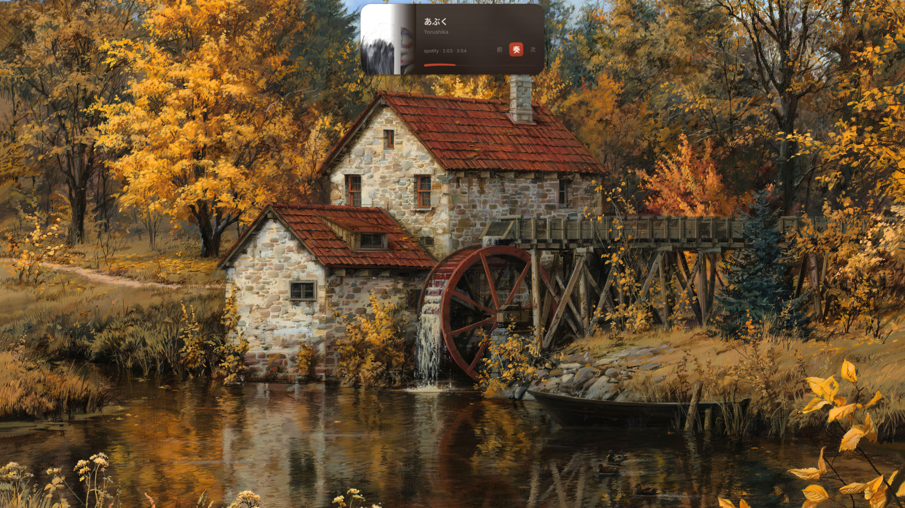
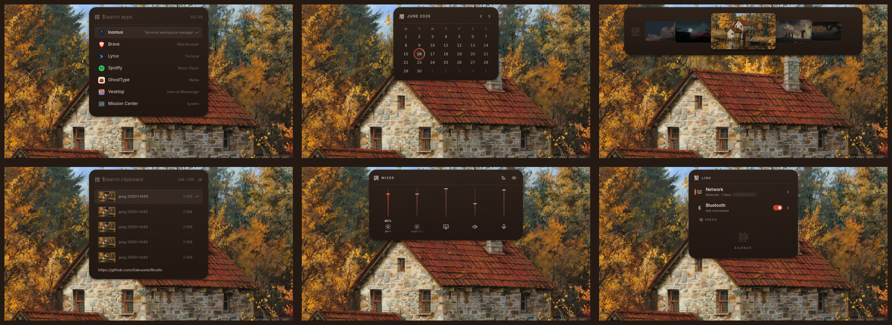
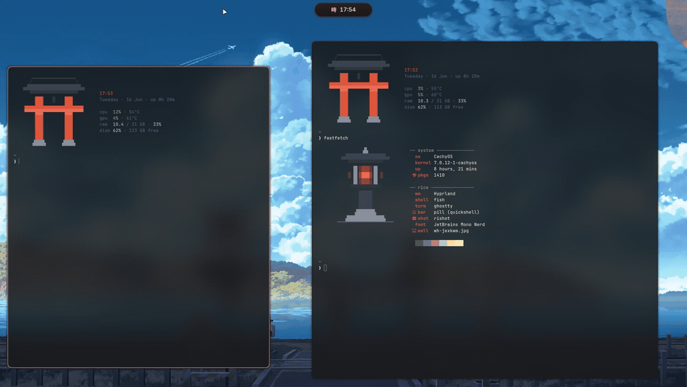
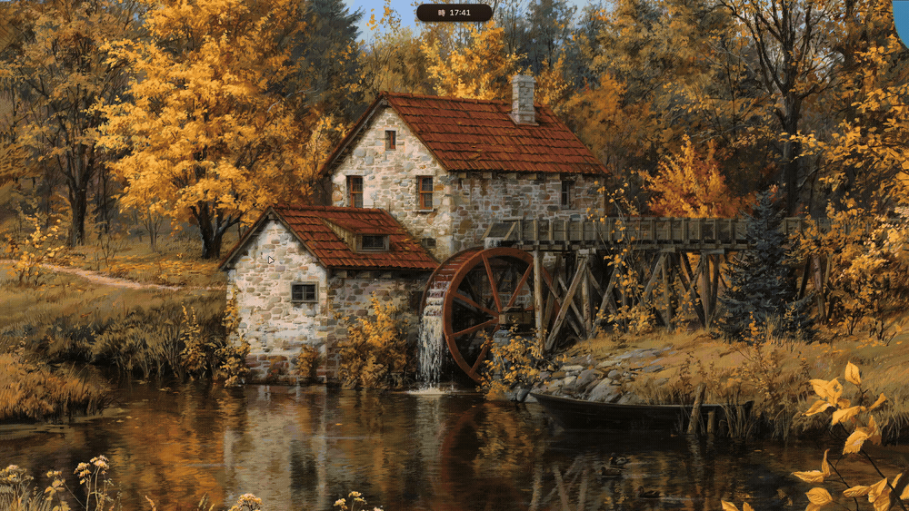

<div align="center">

# Ajodi

**A scrollable-tiling desktop for niri. Hand-crafted Quickshell UI, dynamic wallpaper theming, and zero copied dotfiles.**



</div>

## The shell

Everything you see is hand-written Quickshell. One adaptive pill bar that morphs into whatever surface you need.



The pill becomes media and now playing, a calendar, the wallpaper picker, clipboard history, an audio and brightness mixer, a sound page with a 10-band EQ, AutoEQ headphone profiles, per-app volume and an RNNoise mic filter, and network and bluetooth controls. There is also an app launcher, a custom lock screen, and a settings hub.

## Stack

- Compositor: [niri](https://github.com/YaLTeR/niri) (scrollable-tiling Wayland compositor), configured in KDL
- Shell UI: custom Quickshell with a reactive Niri IPC adapter
- Terminal: Ghostty
- Shell: fish
- Font: JetBrains Mono Nerd
- Colors: matugen, palette pulled dynamically from the wallpaper

matugen extracts a harmonized palette from each wallpaper and recolors the pill, terminal, window focus-ring, fastfetch and GTK apps. The shell itself runs a warm vermilion theme tuned by hand.

<div align="center">





</div>

## Install

> [!WARNING]
> Keep backups before installing on your daily driver. Read `install.sh` first.

One line bootstrap:

```sh
curl -fsSL https://raw.githubusercontent.com/Gakuseei/Ajodi/main/install.sh | bash
```

`install.sh` is a bootstrap: it detects your distro (Arch, Debian, Fedora, openSUSE or Gentoo), ensures git and python3 are installed, clones the rice into `~/.local/share/ajodi`, then hands off to the guided Python installer. It walks you through a short wizard, pulls dependencies, and deploys configs into `~/.config/niri`, `~/.config/quickshell`, `~/.config/ghostty`, and `~/.config/fish`, backing up any existing configurations.

Skip the wizard with flags:

```sh
curl -fsSL https://raw.githubusercontent.com/Gakuseei/Ajodi/main/install.sh | bash -s -- --quickstart
```

```
--quickstart  core defaults, no questions
--full        also install the daily apps (dolphin, keepassxc, zathura, imv, rnote)
--sddm        also install the torii SDDM login theme
--no-deps     skip the package step, just deploy the configs
--dry-run     walk the whole flow and change nothing
```

Once installed, launch `niri` from your display manager or a TTY.

## Keybinds

| Key | Action |
|---|---|
| `Super` + `Return` | Ghostty terminal |
| `Super` + `Space` | App launcher |
| `Super` + `V` | Clipboard history |
| `Super` + `C` | Wallpaper picker |
| `Super` + `B` | Shuffle wallpaper and retheme |
| `Super` + `E` | Dolphin file manager |
| `Super` + `W` | Close window |
| `Super` + `F` | Maximize column |
| `Super` + `Shift` + `F` | Fullscreen window |
| `Super` + `T` | Toggle floating |
| `Super` + `R` | Cycle column width preset |
| `Super` + `Left` / `Right` | Focus column left / right |
| `Super` + `Up` / `Down` | Focus window up / down |
| `Super` + `Shift` + `Left` / `Right` | Move column left / right |
| `Super` + `Shift` + `Up` / `Down` | Move window up / down |
| `Super` + `1` .. `0` | Workspaces 1-10 |
| `Super` + `Shift` + `1` .. `0` | Move column to workspace 1-10 |
| `Super` + `S` | Stash workspace |
| `Super` + `L` | Lock screen |
| `Print` | Interactive screenshot |

## Notes

The installer neutralises hardware-specific bits (display outputs, keyboard layout, and GPU flags) so it boots portably on any machine. Your custom monitor outputs and keybinds in `outputs.kdl` and `binds.kdl` are preserved across rice updates.

## Support

If Ajodi made your setup nicer, you can [buy me a coffee on Ko-fi](https://ko-fi.com/gakuseei).

## Credits

The lock screen, the SDDM background and the wallpapers are not mine. See [CREDITS](configs/sddm/themes/torii/CREDITS.md).

The sound page started as a proposal by [@Seza007](https://github.com/Seza007) in [#31](https://github.com/Gakuseei/Ricelin/issues/31). AutoEQ profiles come from [AutoEq](https://github.com/jaakkopasanen/AutoEq).
